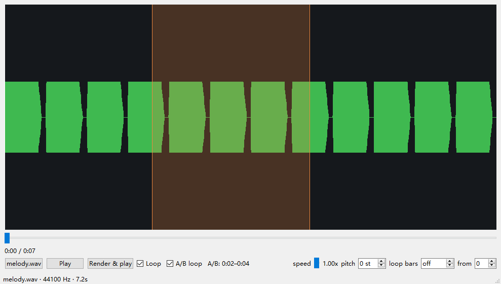
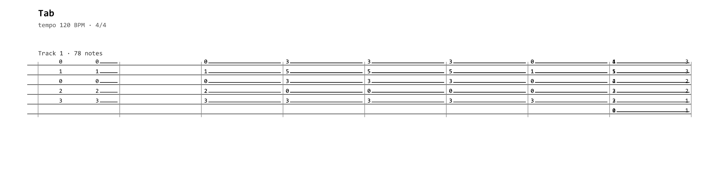
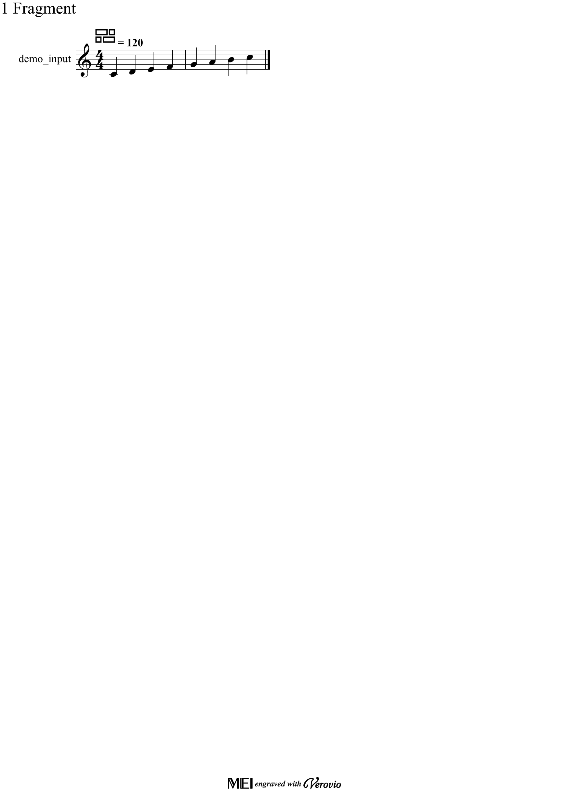
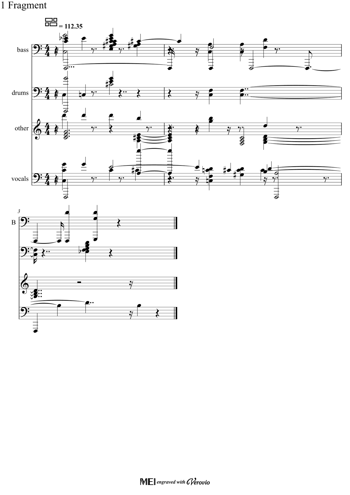

# musicfab — 六个商业音乐软件的开源免费替代

[](https://github.com/WorldTree12306/musicfab/actions/workflows/ci.yml)

musicfab 用开源模型与库重新实现六个常见商业音乐工具的核心能力，全部可离线运行、可脚本化、可批量处理。

| 原商业软件 | musicfab 子命令 | 开源技术栈 |
|---|---|---|
| AnthemScore（音频→乐谱） | `musicfab transcribe` | piano_transcription_inference / basic-pitch / MT3 + Beat-This + music21 |
| Melodyne（音符级修音/变调） | `musicfab shift` / `musicfab notes` | librosa 相位声码器（逐音变调/时值/力度，仅重合成被编辑片段） |
| Transcribe!（慢放/循环/移调） | `musicfab practice` | librosa / Rubber Band + 循环切片 |
| RipX（分轨+转谱+DAW） | `musicfab rip` / `separate` + `daw` + `score` | Demucs + Basic Pitch + 多轨 MIDI/总谱一键出 |
| Capella（记谱/排版） | `musicfab notation` / `score` | music21 + Verovio + resvg，多轨总谱 |
| Guitar Pro（六线谱） | `musicfab tab` | PyGuitarPro 读取 gp3/gp4/gp5 + 自研六线谱 SVG/HTML 渲染 |

> **合规声明**：本项目是 clean-room 实现，只使用开源组件；不包含、不反编译、不分发任何商业软件（AnthemScore、Melodyne、Transcribe!、RipX、Capella、Guitar Pro）的代码、模型权重或授权数据。详见 `docs/LICENSES.md`。



## 示例输出

| 六线谱渲染（Guitar Pro 替代） | 乐谱排版（Capella 替代） | 分轨合成总谱 |
|---|---|---|
|  |  |  |

## 快速开始

```bash
python -m pip install -e .
musicfab --version
musicfab doctor                # 检查依赖与可用功能
musicfab probe your_song.mp3
musicfab transcribe your_song.mp3 -o out.mid --musicxml out.musicxml
musicfab notes your_song.mp3 -o edits.json      # 生成逐音编辑表
musicfab notes your_song.mp3 --edits edits.json -o edited.wav
musicfab notation out.musicxml -o out.pdf -f pdf   # 内置 PDF（PyMuPDF）
musicfab tab song.gp5 -o tab.html -f html           # 六线谱渲染
musicfab beats song.mp3 -o beats.json               # 节奏分析
musicfab practice song.mp3 --loop-beats 8 -o loop.wav  # 按拍点循环
musicfab practice song.mp3 --loop-bars 1 -o bar.wav   # 按小节循环（用检测拍号）
musicfab transcribe song.mp3 --auto-tempo --quantize-beats 2 -o out.mid  # 八分音符网格量化
musicfab separate song.mp3 --transcribe --auto-tempo -o stems/  # 分轨+逐轨转谱
musicfab daw stems/ -o stems/daw/                    # 打包 DAW 工程
musicfab score stems/ -o full.pdf --quantize-beats 1  # 分轨合成总谱
musicfab rip song.wav -o out/ --quantize-beats 1     # RipX 式一键工作流
musicfab rip song.wav -o out/ --no-separate          # 只转谱+总谱（不跑 Demucs，最快）
```

## 子命令

| 命令 | 说明 | 状态 |
|---|---|---|
| `probe` | 查看音频信息（格式/采样率/时长/声道） | ✅ |
| `doctor` | 环境自检：依赖/后端/模型缓存/功能可用性（`--strict`） | ✅ |
| `transcribe` | 音频转 MIDI/MusicXML（AnthemScore 替代） | ✅ basic-pitch(ONNX) / PTI；`--auto-tempo` 自动测速；`--quantize-beats` 按拍点量化 |
| `practice` | 变速/移调/循环练习（Transcribe! 替代） | ✅ `--loop-beats N` 按拍点、`--loop-bars N` 按小节循环 |
| `gui` | 离线练习播放器（波形/拖拽 A/B 选区/变速/移调/按小节循环） | ✅ `pip install "musicfab[gui]"` 后 `musicfab gui file.wav` |
| `shift` | 整段变调（Melodyne 替代） | ✅ |
| `notes` | 逐音编辑 + 重合成（Melodyne 替代） | ✅ 变调/时值/力度，只改选中音符 |
| `separate` | 分轨（RipX 替代） | ✅ htdemucs 4 轨；分块 overlap-add；`--transcribe` 逐轨转谱 + `--auto-tempo` + `--quantize-beats` |
| `notation` | 记谱/排版/导出（Capella 替代） | ✅ 支持 `.mfproj.json` 直接排版；`--quantize-beats` 量化；SVG/PDF/PNG（resvg+PyMuPDF） |
| `score` | 分轨工程合成多轨总谱（Capella/RipX） | ✅ 每 stem 一个声部，可直接出 MusicXML/PDF/PNG/SVG |
| `tab` | 六线谱导入/渲染（Guitar Pro 替代） | ✅ `.gp3/.gp4/.gp5` → JSON/MIDI/MusicXML/SVG/HTML |
| `beats` | 速度/拍点/下拍估计 | ✅ 输出 JSON（tempo/beats/downbeats + 低频重音相位/置信度） |
| `daw` | 分轨工程打包（RipX 替代） | ✅ 多轨 MIDI + tracks.json + README + 拍点/小节 `grid.json` |
| `rip` | 一键工作流：分轨→转谱→DAW→总谱（RipX 替代） | ✅ 一条命令产出 stems/projects/MIDI/daw/score；`--no-separate` 轻量模式只转谱+出谱 |

## 安装可选后端

```bash
# 转谱（默认 ONNX 后端，无需 TensorFlow；模型 230 KB 随包）
pip install basic-pitch --no-deps
pip install mir_eval scikit-learn "resampy>=0.4.2,<0.4.3"

# 钢琴专用转谱（可选，质量更好，需要 torch）
pip install piano_transcription_inference

# 分轨（RipX 替代）
pip install "demucs==4.0.1" --no-deps
pip install dora-search openunmix einops julius lameenc pyyaml tqdm
pip install torch torchaudio --index-url https://download.pytorch.org/whl/cpu

# 六线谱 / 渲染 / PDF 导出
pip install pyguitarpro verovio pymupdf
# PDF/PNG 导出另需 MuseScore 4（GPL，仅子进程调用）
```

> 说明：`basic-pitch` 在 PyPI 上声明 TensorFlow 依赖（Windows/py3.11+），但本项目走 **ONNX 后端**，用 `--no-deps` 安装即可避免 600 MB 的 TensorFlow，实测完全可用。

## 项目格式

统一的 JSON 工程（`.mfproj.json`）：

```json
{
  "format": "musicfab-project",
  "version": 1,
  "name": "song",
  "audio": {"path": "song.wav", "sample_rate": 44100},
  "tempo": 120.0,
  "beats": [],
  "tracks": [{"name": "main", "instrument": 0,
              "notes": [{"start": 0.0, "end": 0.5, "pitch": 60, "velocity": 80}]}],
  "meta": {}
}
```

## 开发

```bash
python -m pip install -e ".[dev]"
pytest -q
python scripts/gen_test_audio.py    # 生成测试音频
```

## License

代码审查记录与已知限制见 `docs/REVIEW.md`。能力对照见 [`docs/COMPARISON.md`](docs/COMPARISON.md)，变更记录见 [`CHANGELOG.md`](CHANGELOG.md)，发布流程与回归记录见 [`docs/RELEASE.md`](docs/RELEASE.md) / [`docs/REGRESSION.md`](docs/REGRESSION.md)。本项目代码 MIT。第三方组件许可证见 `docs/LICENSES.md`；其中 GPL 工具（MuseScore、Rubber Band 等）一律以**子进程**方式调用，不作为库链接，避免许可证传染。
